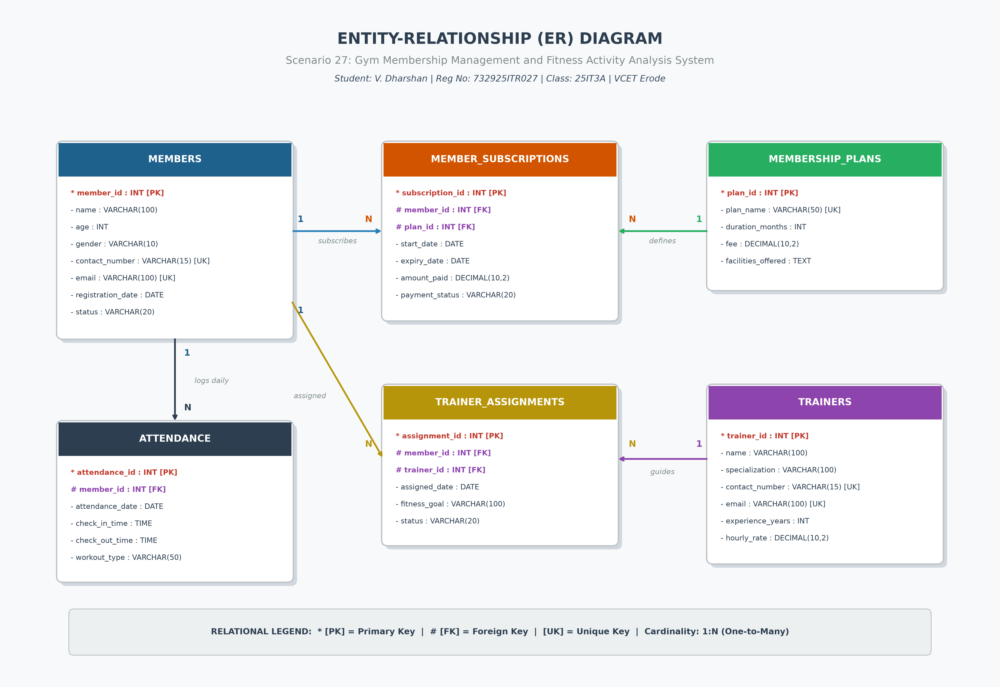

# Gym Membership Management and Fitness Activity Analysis System
### Scenario 27 — Project-Based Assessment (Academic Year: 2026 - 27 ODD)

**Student Name:** V. Dharshan  
**Register Number:** `732925ITR027`  
**Class:** 25IT3A  
**Department:** Department of Information Technology  
**Institution:** Velalar College of Engineering and Technology, Erode - 12  

---

## 📌 1. Project Overview & Problem Statement

Fitness centres and gyms routinely face operational difficulties when relying on manual recordkeeping for member registrations, multi-tier subscription plans, daily check-in/out attendance logging, and trainer allocations. Without systematic digitization:
- Tracking expiring memberships and coordinating renewals is error-prone.
- Monitoring peak workout hours and equipment utilization is difficult.
- Evaluating trainer workloads and client progress lacks objective metrics.

This project delivers an integrated, production-grade **Gym Membership Management and Fitness Activity Analysis System** uniting **Relational Database Management (SQLite/DBMS)**, **Object-Oriented Enterprise Application Development (Java 26)**, **Software Engineering Lifecycle Documentation (IEEE SRS, UML Design, Quality Assurance Testing)**, and **Exploratory Data Science & Visual Analytics (Python 3.13, Pandas, Matplotlib, Seaborn)**.

---

## 🎓 2. Syllabus & Course Integration

| Course Code | Course Name | Integrated System Concepts |
| :--- | :--- | :--- |
| **25ITT31** | **Database Management Systems** | Normalized SQLite schema (1NF $\rightarrow$ BCNF), relational integrity constraints, foreign key cascades, views, aggregations, seed dataset. |
| **25ITT32** | **Java Programming** | OOP inheritance (`BaseEntity`), Generic DAO interfaces (`CrudRepository<T>`), JDBC connectivity, custom exception hierarchy, Collections & Streams API, multithreaded daemon report workers. |
| **25ITT33** | **Software Engineering** | IEEE 830 compliant SRS, Use Case diagrams, Class diagrams, Layered System Architecture, 19 black-box/unit/integration test cases with expected vs actual results. |
| **25ITC31** | **Foundations of Data Science** | SQLite database extraction via Python, Pandas data wrangling, missing-value imputation, IQR outlier detection, feature engineering, Matplotlib/Seaborn visualization pipeline, interactive Jupyter Notebook (`.ipynb`). |

---

## 🛠️ 3. Technologies Used

- **Programming Languages:** Java 26 (SE Runtime), Python 3.13
- **Database:** SQLite 3 (embedded zero-setup relational database)
- **Java Libraries / Drivers:** `sqlite-jdbc-3.45.3.0`, `slf4j-api-2.0.13`, `slf4j-simple-2.0.13`
- **Python Data Science Stack:** Pandas, NumPy, Matplotlib, Seaborn, Jupyter / nbformat
- **UI Paradigms:** Dual-mode (Interactive ANSI Console CLI + Java Swing Desktop GUI)

---

## 📁 4. Project Directory Structure

```text
D:\Project
├── database/
│   ├── gym.db                              # Active SQLite database with seed records
│   ├── schema.sql                          # DDL script (tables, constraints, views)
│   └── seed_data.sql                       # DML script (members, plans, trainers, attendance)
├── src/
│   └── com/gym/
│       ├── Main.java                       # Application entry point (CLI / GUI switcher)
│       ├── model/                          # Entity models (BaseEntity, Member, Plan, Trainer, etc.)
│       ├── dao/                            # Data Access Layer & JDBC Singleton Connection
│       ├── exception/                      # Custom domain exception hierarchy
│       ├── service/                        # Business logic, Streams, and Multithreaded workers
│       └── ui/                             # ConsoleUI (CLI) and GymAppGUI (Swing Desktop)
├── bin/                                    # Compiled Java bytecode (.class files)
├── lib/                                    # SQLite JDBC driver and SLF4J dependencies
│   ├── sqlite-jdbc-3.45.3.0.jar
│   ├── slf4j-api-2.0.13.jar
│   └── slf4j-simple-2.0.13.jar
├── python/
│   ├── db_retrieval.py                     # Database extraction using sqlite3 & pandas
│   ├── data_preprocessing.py               # Data wrangling, IQR outlier analysis, time features
│   ├── visualize_activity.py               # Matplotlib & Seaborn visualization generation
│   └── gym_activity_analysis.ipynb         # Executed Jupyter Notebook with inline plots
├── visualizations/                         # High-resolution generated analytical charts
│   ├── 01_attendance_by_day_of_week.png
│   ├── 02_plan_popularity_and_revenue.png
│   ├── 03_trainer_workload_distribution.png
│   ├── 04_workout_type_preference_pie.png
│   ├── 05_hourly_checkin_heatmap.png
│   └── 06_member_age_distribution_boxplot.png
├── docs/                                   # Software Engineering & DBMS Documentation
│   ├── er_diagram.png                      # High-resolution Entity-Relationship Diagram
│   ├── SRS.md                              # IEEE 830 Software Requirements Specification
│   ├── SYSTEM_DESIGN.md                    # System Architecture, Use Case & Class Diagrams
│   ├── ER_AND_NORMALIZATION.md             # ER Diagram, Relational Model, 1NF to BCNF Proof
│   ├── TESTING.md                          # Testing Strategy & 19 Comprehensive Test Cases
│   └── SAMPLE_INPUT_OUTPUT.md              # Sample Inputs and Outputs for Viva / Evaluation
└── README.md                               # Root project documentation
```

---

## 🗄️ 5. Entity-Relationship (ER) Diagram

The normalized relational database schema follows strict 3NF/BCNF standards across 6 core entities:



---

## 🚀 6. Execution Instructions

### A. Running the Java Application

#### 1. Compile Java Source Code
```powershell
javac -cp "lib/*" -d bin (Get-ChildItem -Path "src" -Recurse -Filter "*.java").FullName
```

#### 2. Run Interactive Console CLI Mode (Default)
```powershell
java -cp "bin;lib/*" com.gym.Main
```

#### 3. Run Swing Desktop GUI Mode
```powershell
java -cp "bin;lib/*" com.gym.Main --gui
```

---

### B. Running the Python Analytics & Visualizations

#### 1. Run Data Preprocessing and Generate Charts
```powershell
python python/visualize_activity.py
```
*All charts will be saved directly into the `visualizations/` directory.*

#### 2. Open the Interactive Jupyter Notebook
```powershell
python -m notebook python/gym_activity_analysis.ipynb
```
*(or open `python/gym_activity_analysis.ipynb` directly in VS Code / Jupyter Lab).*

---

## 📊 7. Key Data Science Insights & Generated Visualizations

The Python data analytics pipeline discovered the following behavioral insights from gym records:

| Chart Preview | Analytical Insight |
| :--- | :--- |
| **`01_attendance_by_day_of_week.png`** | **Peak Weekday Attendance:** Attendance surges on Mondays and Wednesdays, tapering off towards weekends. Morning shifts dominate weekdays (6:00 AM–8:30 AM). |
| **`02_plan_popularity_and_revenue.png`** | **Revenue Driver:** The *Platinum Annual* and *Gold Half-Yearly* plans generate over 60% of gym revenue despite having fewer total subscribers than the Monthly Basic plan. |
| **`03_trainer_workload_distribution.png`** | **Trainer Allocation:** Trainers Rajesh Kumar (Strength) and Vikram Chandran (Bodybuilding) carry the highest active member count, indicating strong client focus on resistance training. |
| **`04_workout_type_preference_pie.png`** | **Discipline Distribution:** Weight Training (45.2%) and Cardio (22.6%) comprise more than two-thirds of all logged workouts. |
| **`05_hourly_checkin_heatmap.png`** | **Rush Hour Patterns:** Two distinct rush spikes occur daily: 06:00–08:30 AM (morning rush) and 17:30–20:00 PM (evening rush). |
| **`06_member_age_distribution_boxplot.png`** | **Demographics:** The average member age is 29.3 years (median 27 years), with the primary demographic bracket falling between 21 and 35 years. |

---

## 📑 8. Documentation Index

- 📘 [Software Requirements Specification (SRS)](docs/SRS.md)
- 📐 [System Design & Architecture (Use Case, Class Diagrams)](docs/SYSTEM_DESIGN.md)
- 🗄️ [ER Diagram, Relational Model & Normalization (1NF to BCNF)](docs/ER_AND_NORMALIZATION.md)
- 🧪 [Software Testing Document & Test Cases](docs/TESTING.md)
- 📋 [Sample Inputs & Outputs for Lab Viva](docs/SAMPLE_INPUT_OUTPUT.md)

---

## 👤 9. Author Information
- **Name:** V. Dharshan
- **Register Number:** `732925ITR027`
- **Class:** 25IT3A
- **Department:** Information Technology
- **College:** Velalar College of Engineering and Technology, Erode - 12
