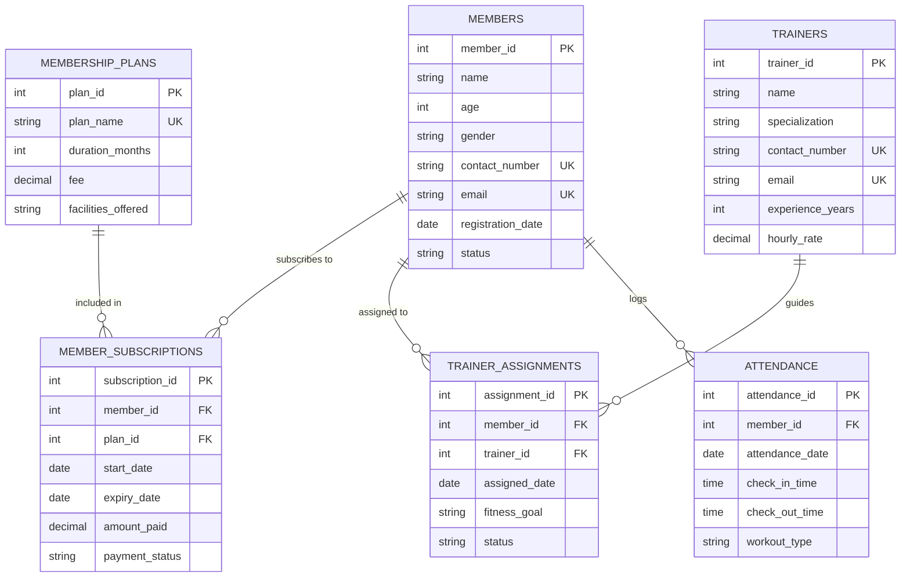

# Database Design, ER Modeling & Normalization Document
## Gym Membership Management and Fitness Activity Analysis System

**Student Name:** V. Dharshan  
**Register Number:** 732925ITR027  
**Class:** 25IT3A  
**Course:** 25ITT31 - Database Management Systems  
**Academic Year:** 2026 - 27 (ODD)  
**Institution:** Velalar College of Engineering and Technology, Erode - 12  
**Department:** Department of Information Technology  

---

## 1. Entity-Relationship (ER) Diagram

The system models six major entities with well-defined primary keys, foreign key constraints, and relational cardinalities.



---

## 2. Relational Model & Schema Mapping

The relational schema translates the conceptual ER diagram into structured relational tables with explicit referential integrity rules:

1. **`members`** (
   **`member_id`** [PK], `name`, `age`, `gender`, `contact_number` [UK], `email` [UK], `registration_date`, `status`
)
2. **`membership_plans`** (
   **`plan_id`** [PK], `plan_name` [UK], `duration_months`, `fee`, `facilities_offered`
)
3. **`trainers`** (
   **`trainer_id`** [PK], `name`, `specialization`, `contact_number` [UK], `email` [UK], `experience_years`, `hourly_rate`
)
4. **`member_subscriptions`** (
   **`subscription_id`** [PK], *`member_id`* [FK -> members.member_id ON DELETE CASCADE], *`plan_id`* [FK -> membership_plans.plan_id], `start_date`, `expiry_date`, `amount_paid`, `payment_status`
)
5. **`trainer_assignments`** (
   **`assignment_id`** [PK], *`member_id`* [FK -> members.member_id ON DELETE CASCADE], *`trainer_id`* [FK -> trainers.trainer_id ON DELETE CASCADE], `assigned_date`, `fitness_goal`, `status`
)
6. **`attendance`** (
   **`attendance_id`** [PK], *`member_id`* [FK -> members.member_id ON DELETE CASCADE], `attendance_date`, `check_in_time`, `check_out_time`, `workout_type`
)

---

## 3. Database Normalization Analysis

Database normalization systematically decomposes relations to eliminate insertion, deletion, and update anomalies while avoiding redundant data storage.

### 3.1 Initial Unnormalized Form (UNF)
In an unnormalized legacy spreadsheet or manual log, a single record might contain:
```
UNF_GYM_RECORD(
    MemberID, MemberName, Age, Gender, Contact, Email, RegDate,
    PlanID, PlanName, PlanDuration, PlanFee, Facilities,
    StartDate, ExpiryDate, AmountPaid,
    TrainerID, TrainerName, TrainerSpecialization, TrainerContact, FitnessGoal,
    {AttendanceDate, CheckInTime, CheckOutTime, WorkoutType}
)
```
- **Problems:** Repeating groups for attendance sessions; repeating trainer details for every workout log; repeating plan definitions for every member subscription.

---

### 3.2 First Normal Form (1NF)
> **Definition:** A relation is in 1NF if and only if all attribute domains contain only atomic (indivisible) values and there are no repeating groups.

**Actions taken:**
- Removed nested repeating attendance groups into a dedicated `attendance` relation.
- Ensured single atomic entries for all contacts, names, and fees.
- Assigned unique primary keys to identify tuples.

Relations in 1NF:
- `MEMBERS_PLANS_SUBSCRIPTIONS(member_id, name, age, gender, contact, email, reg_date, plan_id, plan_name, duration, fee, facilities, start_date, expiry_date, amount_paid)`
- `TRAINER_ASSIGNMENTS(assignment_id, member_id, trainer_id, trainer_name, specialization, trainer_contact, assigned_date, fitness_goal)`
- `ATTENDANCE(attendance_id, member_id, attendance_date, check_in_time, check_out_time, workout_type)`

---

### 3.3 Second Normal Form (2NF)
> **Definition:** A relation is in 2NF if it is in 1NF and every non-prime attribute is fully functionally dependent on the entire primary key (no partial functional dependencies).

**Functional Dependency Analysis:**
- In `MEMBERS_PLANS_SUBSCRIPTIONS`:
  - `member_id` $\rightarrow$ `name`, `age`, `gender`, `contact`, `email`, `reg_date`
  - `plan_id` $\rightarrow$ `plan_name`, `duration`, `fee`, `facilities`
  - `(member_id, plan_id, start_date)` $\rightarrow$ `expiry_date`, `amount_paid`
- Here, plan attributes depended only on part of the composite identifier (`plan_id`), representing a **partial dependency**.

**Decomposition to 2NF:**
1. Split out `members` with candidate key `member_id`.
2. Split out `membership_plans` with candidate key `plan_id`.
3. Create `member_subscriptions` with surrogate key `subscription_id` and foreign keys `member_id` and `plan_id`.

Similarly, for trainers:
- In `TRAINER_ASSIGNMENTS`, trainer attributes (`trainer_name`, `specialization`, `trainer_contact`) depended strictly on `trainer_id`.
- Decomposed into `trainers` and `trainer_assignments`.

---

### 3.4 Third Normal Form (3NF)
> **Definition:** A relation is in 3NF if it is in 2NF and there is no transitive dependency (no non-prime attribute depends on another non-prime attribute: $X \rightarrow Y$ and $Y \rightarrow Z$).

**Verification of 3NF across all entities:**
1. **`members` table:**
   - Keys: `member_id` (PK), `contact_number` (UK), `email` (UK).
   - Dependencies: `member_id` $\rightarrow$ `name`, `age`, `gender`, `contact_number`, `email`, `registration_date`, `status`.
   - No non-prime attribute determines another non-prime attribute. $\rightarrow$ **Satisfies 3NF**.
2. **`membership_plans` table:**
   - Keys: `plan_id` (PK), `plan_name` (UK).
   - Dependencies: `plan_id` $\rightarrow$ `plan_name`, `duration_months`, `fee`, `facilities_offered`.
   - All non-prime attributes depend solely on candidate keys. $\rightarrow$ **Satisfies 3NF**.
3. **`member_subscriptions` table:**
   - Key: `subscription_id` (PK).
   - Dependencies: `subscription_id` $\rightarrow$ `member_id`, `plan_id`, `start_date`, `expiry_date`, `amount_paid`, `payment_status`.
   - `member_id` and `plan_id` are foreign keys, but neither determines the transactional `amount_paid` or `start_date` of another record. $\rightarrow$ **Satisfies 3NF**.
4. **`trainers` table:**
   - Key: `trainer_id` (PK).
   - Dependencies: `trainer_id` $\rightarrow$ `name`, `specialization`, `contact_number`, `email`, `experience_years`, `hourly_rate`. $\rightarrow$ **Satisfies 3NF**.
5. **`attendance` table:**
   - Key: `attendance_id` (PK).
   - Dependencies: `attendance_id` $\rightarrow$ `member_id`, `attendance_date`, `check_in_time`, `check_out_time`, `workout_type`. $\rightarrow$ **Satisfies 3NF**.

---

### 3.5 Boyce-Codd Normal Form (BCNF)
> **Definition:** A relation is in BCNF if for every non-trivial functional dependency $X \rightarrow Y$, the determinant $X$ is a superkey.

- In every relation in our design:
  - `member_id` is a Superkey in `members`.
  - `plan_id` is a Superkey in `membership_plans`.
  - `trainer_id` is a Superkey in `trainers`.
  - `subscription_id` is a Superkey in `member_subscriptions`.
  - `assignment_id` is a Superkey in `trainer_assignments`.
  - `attendance_id` is a Superkey in `attendance`.
- Since every determinant is a superkey, the database is strictly in **Boyce-Codd Normal Form (BCNF)**.

---

## 4. Database Views & Advanced Queries

The database implementation defines 5 analytical views and queries supporting the course syllabus (Unit 2: SQL Joins, Views, Aggregations):

### View 1: Active Memberships with Calculated Days Remaining
```sql
CREATE VIEW vw_active_memberships AS
SELECT 
    s.subscription_id,
    m.member_id,
    m.name AS member_name,
    m.contact_number,
    p.plan_name,
    s.start_date,
    s.expiry_date,
    s.amount_paid,
    CASE 
        WHEN date(s.expiry_date) < date('now') THEN 'Expired'
        WHEN date(s.expiry_date) BETWEEN date('now') AND date('now', '+7 days') THEN 'Expiring Soon'
        ELSE 'Active'
    END AS subscription_status,
    CAST((julianday(s.expiry_date) - julianday('now')) AS INTEGER) AS days_remaining
FROM member_subscriptions s
JOIN members m ON s.member_id = m.member_id
JOIN membership_plans p ON s.plan_id = p.plan_id;
```

### View 2: Expiring Memberships (Renewal Follow-up Alert)
```sql
CREATE VIEW vw_expiring_soon AS
SELECT 
    m.member_id,
    m.name AS member_name,
    m.contact_number,
    m.email,
    p.plan_name,
    s.expiry_date,
    CAST((julianday(s.expiry_date) - julianday('now')) AS INTEGER) AS days_left
FROM member_subscriptions s
JOIN members m ON s.member_id = m.member_id
JOIN membership_plans p ON s.plan_id = p.plan_id
WHERE date(s.expiry_date) BETWEEN date('now') AND date('now', '+7 days');
```

### View 3: Trainer Client Allocation Workload
```sql
CREATE VIEW vw_trainer_workload AS
SELECT 
    t.trainer_id,
    t.name AS trainer_name,
    t.specialization,
    COUNT(ta.assignment_id) AS active_clients
FROM trainers t
LEFT JOIN trainer_assignments ta ON t.trainer_id = ta.trainer_id AND ta.status = 'Active'
GROUP BY t.trainer_id, t.name, t.specialization;
```

### View 4: Revenue & Subscription Summary by Plan
```sql
CREATE VIEW vw_revenue_by_plan AS
SELECT 
    p.plan_id,
    p.plan_name,
    p.duration_months,
    p.fee,
    COUNT(s.subscription_id) AS total_subscriptions,
    COALESCE(SUM(s.amount_paid), 0.0) AS total_revenue
FROM membership_plans p
LEFT JOIN member_subscriptions s ON p.plan_id = s.plan_id
GROUP BY p.plan_id, p.plan_name, p.duration_months, p.fee;
```
