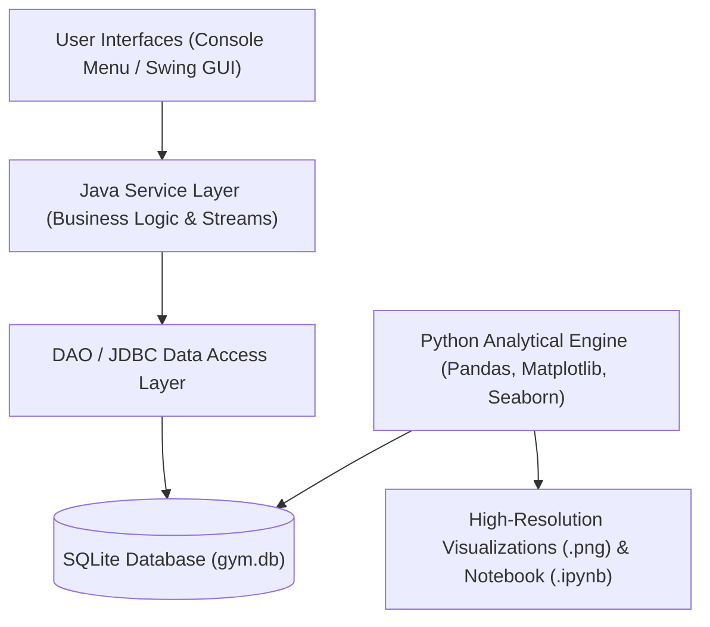

# Software Requirements Specification (SRS)
## Gym Membership Management and Fitness Activity Analysis System

**Scenario 27 (Register No.: 27, 57, 87, 117)**  
**Student Name:** V. Dharshan  
**Register Number:** 732925ITR027  
**Class:** 25IT3A  
**Course:** 25ITT33 - Software Engineering  
**Academic Year:** 2026 - 27 (ODD)  
**Institution:** Velalar College of Engineering and Technology, Erode - 12  
**Department:** Department of Information Technology  

---

## 1. Introduction

### 1.1 Purpose
The purpose of this document is to provide a detailed Software Requirements Specification (SRS) for the **Gym Membership Management and Fitness Activity Analysis System**. This specification outlines both the functional and non-functional requirements, architectural choices, interface designs, and system constraints required to streamline gym administration, member tracking, trainer allocation, and data-driven fitness activity analysis.

### 1.2 Scope of the System
The software addresses challenges arising from manual and fragmented gym recordkeeping:
- Centralized storage of member personal records, emergency contacts, and active memberships.
- Structured pricing and benefits tiers through customizable membership plans.
- Automated status detection for active, expiring, and lapsed subscriptions.
- Daily digital attendance logs recording check-in/out timestamps and exercise disciplines.
- Balanced trainer assignment matching client fitness ambitions with certified trainer expertise.
- Visual exploratory data analysis and trend visualization using Python data science libraries.

### 1.3 Definitions, Acronyms, and Abbreviations
- **DBMS:** Database Management System
- **GUI:** Graphical User Interface
- **CLI:** Command Line Interface
- **JDBC:** Java Database Connectivity
- **EDA:** Exploratory Data Analysis
- **1NF / 2NF / 3NF / BCNF:** Normal Form stages in relational database normalization
- **SRS:** Software Requirements Specification
- **IEEE:** Institute of Electrical and Electronics Engineers

### 1.4 References
- IEEE Std 830-1998: Recommended Practice for Software Requirements Specifications.
- Syllabus for 25ITT31 (Database Management Systems), 25ITT32 (Java Programming), 25ITT33 (Software Engineering), 25ITC31 (Foundations of Data Science).

---

## 2. Overall Description

### 2.1 Product Perspective
The Gym Management System is a self-contained, multi-tier software application integrating:
1. **Relational Data Tier (SQLite/DBMS):** Stores normalized records for members, plans, trainers, subscriptions, assignments, and attendance logs.
2. **Application & Business Logic Tier (Java 26):** Implements object-oriented principles, CRUD repositories, stream processing, multithreaded reporting, and validation routines.
3. **User Presentation Tier (CLI & Swing GUI):** Provides intuitive terminal and visual controls for gym receptionists and administrators.
4. **Analytical Data Tier (Python 3.13):** Connects to the database to perform preprocessing, IQR outlier detection, time-series aggregation, and visualization via Matplotlib/Seaborn.

### 2.2 User Characteristics
- **Gym Administrator / Receptionist:** Handles member registration, assigns membership plans, monitors subscription expiry, takes attendance, and generates revenue summaries.
- **Fitness Trainer:** Reviews assigned clients, monitors member fitness goals, and observes client consistency.
- **Gym Manager / Analyst:** Evaluates facility utilization, rush hour heatmaps, trainer workload balance, and revenue performance via Python analytical charts.

### 2.3 Operating Environment
- **Operating System:** Windows 10/11, Linux, or macOS.
- **Runtime Environments:** Java SE Runtime Environment (JDK 21+ / Java 26), Python 3.10+ (Python 3.13 tested).
- **Storage:** SQLite 3 embedded database.

### 2.4 Design and Implementation Constraints
- The database schema must be strictly normalized up to 3NF/BCNF.
- All foreign keys must enforce referential integrity (`PRAGMA foreign_keys = ON;`).
- Custom exceptions must be implemented for domain failures (e.g. `ValidationException`, `EntityNotFoundException`).
- All data retrieval in Python must use parameterized database queries and clean DataFrame structures.

---

## 3. Specific Functional Requirements

### FR-01: Member Profile Management
- **FR-01.1:** The system shall record member details including Member ID (auto-generated), full name, age (14–90), gender, 10-digit contact number, email, and registration date.
- **FR-01.2:** The system shall support searching members by name keyword or contact number.
- **FR-01.3:** The system shall allow updating member status (`Active`, `Inactive`, `Suspended`).

### FR-02: Membership Plan Management
- **FR-02.1:** The system shall maintain distinct membership tiers (e.g. Monthly, Quarterly, Half-Yearly, Annual).
- **FR-02.2:** Each plan shall store plan ID, plan name, validity duration in months, fee amount (₹), and facilities offered.
- **FR-02.3:** The system shall enforce non-negative fee values and positive durations.

### FR-03: Membership Registration and Renewal
- **FR-03.1:** The system shall associate a member with a chosen membership plan and record start date and calculated expiry date.
- **FR-03.2:** The system shall support membership renewals by extending validity from the previous expiration date or current date.
- **FR-03.3:** The system shall log payment transactions and payment status (`Paid`, `Pending`).

### FR-04: Daily Attendance Tracking
- **FR-04.1:** The system shall log daily check-ins capturing Member ID, attendance date, check-in time, and workout discipline.
- **FR-04.2:** The system shall verify that a member is not checked in multiple times concurrently without checking out.
- **FR-04.3:** The system shall record checkout timestamps and calculate duration of gym sessions.

### FR-05: Trainer Profile & Assignment Management
- **FR-05.1:** The system shall maintain trainer profiles containing Trainer ID, name, specialization, contact information, and years of experience.
- **FR-05.2:** The system shall associate members with trainers based on fitness targets (e.g., Weight Loss, Strength Progression, Hypertrophy, Mobility).
- **FR-05.3:** The system shall prevent assigning inactive trainers or reassigning completed goals.

### FR-06: Status Tracking & Renewal Alerts
- **FR-06.1:** The system shall calculate days remaining on every active membership.
- **FR-06.2:** The system shall automatically categorize subscriptions into `Active`, `Expiring Soon` (within 7 days), and `Expired`.
- **FR-06.3:** The system shall generate notification lists for expiring members to trigger renewal follow-ups.

### FR-07: Business Reporting & Revenue Analytics
- **FR-07.1:** The system shall aggregate total gym revenue across plans using Java Stream operations.
- **FR-07.2:** The system shall compute client workload distribution per trainer.
- **FR-07.3:** The system shall provide an asynchronous multithreaded worker for compiling audit reports without blocking the user interface.

### FR-08: Python Data Retrieval & Preprocessing
- **FR-08.1:** Python scripts shall query the SQLite database and extract relational tables into Pandas DataFrames.
- **FR-08.2:** The preprocessing pipeline shall clean missing fields, detect duplicates, and parse timestamps into hours and weekdays.
- **FR-08.3:** The pipeline shall apply IQR statistical analysis to identify demographic outliers.

### FR-09: Data Visualization & Activity Insights
- **FR-09.1:** The system shall generate bar charts comparing gym visits across weekdays for morning vs. evening shifts.
- **FR-09.2:** The system shall plot plan popularity versus revenue generation.
- **FR-09.3:** The system shall generate a peak-hour traffic heatmap (Hour vs. Weekday).
- **FR-09.4:** The system shall plot workout discipline preferences (donut chart) and member age spreads (box plot).

---

## 4. External Interface Requirements

### 4.1 User Interfaces
- **Console Interface:** ANSI-styled interactive menu with numbered commands, tabular output formatting, and defensive input traps.
- **Swing Desktop GUI:** Multi-tabbed window containing summary metric cards, interactive `JTable` views with scrolling, action buttons, and live refresh capabilities.

### 4.2 Software Interfaces
- **Java SE 26 Runtime:** Application execution and memory management.
- **SQLite JDBC Driver (`sqlite-jdbc-3.45.3.0`):** Type 4 database connectivity.
- **SLF4J Logging API (`slf4j-api-2.0.13`):** Driver logging abstraction.
- **Python 3.13 Runtime:** Executes Pandas, NumPy, Matplotlib, and Seaborn scripts.

---

## 5. Non-Functional Requirements

### 5.1 Performance Requirements
- Console and GUI queries must respond in under 150 milliseconds for typical gym database sizes (up to 100,000 records).
- Python batch visualization generation must complete within 5 seconds.

### 5.2 Reliability & Fault Tolerance
- Database integrity must be maintained using ACID transaction standards.
- Invalid user input (e.g., negative fees, non-numeric phone numbers, alphabetic ages) must be caught by validation layers without crashing the application.

### 5.3 Security & Integrity
- Phone numbers and email addresses must be constrained as unique keys to prevent duplicate member registration.
- Foreign keys must enforce cascading deletes or restrictions where appropriate.

### 5.4 Maintainability & Extensibility
- Clean separation of concerns following DAO, Service, Model, and Presentation layers.
- Object-oriented design enables effortless swapping of SQLite with MySQL or PostgreSQL by modifying only `DatabaseConnection.java`.
