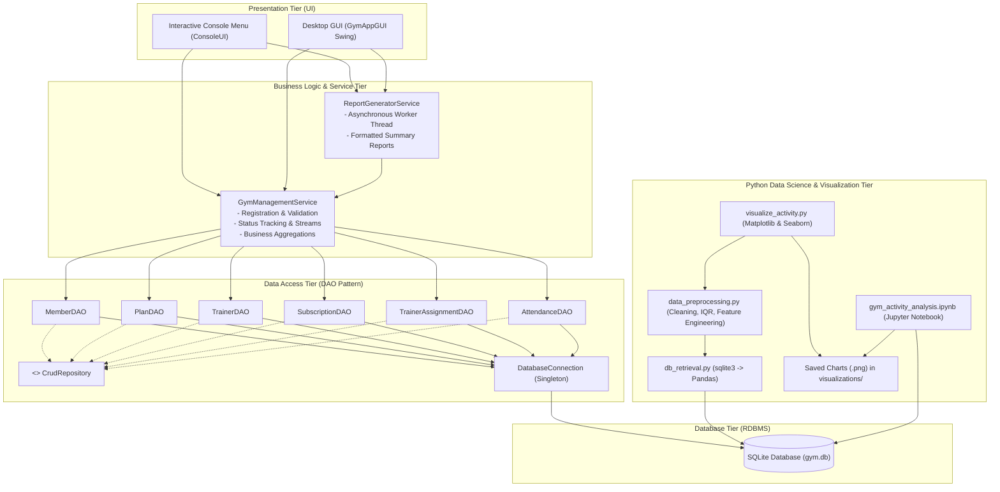
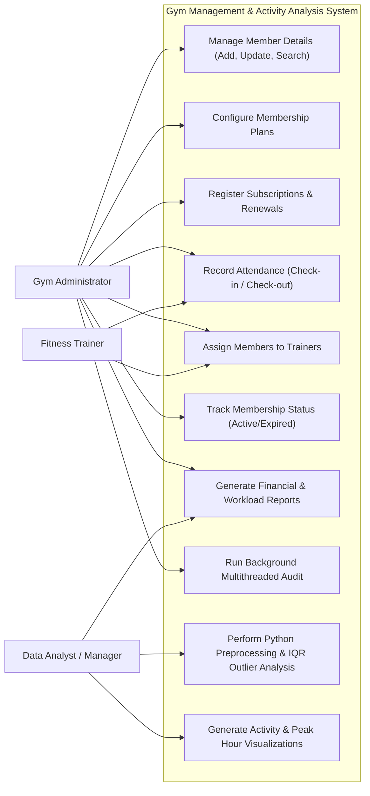
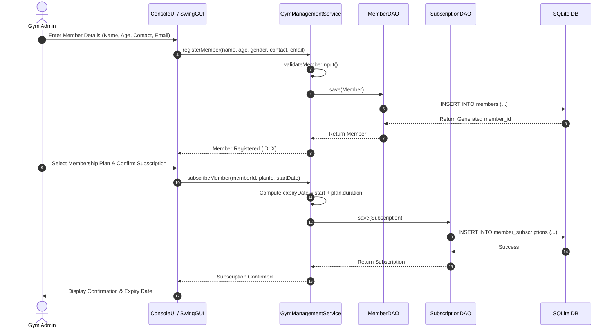

# System Design and Architecture Document
## Gym Membership Management and Fitness Activity Analysis System

**Student Name:** V. Dharshan  
**Register Number:** 732925ITR027  
**Class:** 25IT3A  
**Course:** 25ITT33 - Software Engineering  
**Academic Year:** 2026 - 27 (ODD)  
**Institution:** Velalar College of Engineering and Technology, Erode - 12  
**Department:** Department of Information Technology  

---

## 1. System Architecture

The system adopts a modular **N-Tier Layered Architecture** with distinct separation between Presentation, Service / Business Logic, Data Access (DAO), and Persistence tiers, coupled with an analytical pipeline in Python.

---

## 2. Use Case Diagram

The primary actors interacting with the system are:
1. **Gym Administrator / Receptionist:** Handles daily gym operations.
2. **Fitness Trainer:** Observes training assignments and schedules.
3. **Data Analyst / Gym Manager:** Evaluates facility usage and revenue trends.

---

## 3. Class Diagram

The class structure adheres strictly to Object-Oriented principles, leveraging inheritance, encapsulation, generics, and interface contracts.

```mermaid
classDiagram
    direction TB

    class BaseEntity {
        <<abstract>>
        #int id
        +getId() int
        +setId(int id) void
    }

    class Member {
        -String name
        -int age
        -String gender
        -String contactNumber
        -String email
        -LocalDate registrationDate
        -String status
        +getMemberId() int
        +getName() String
        +getAge() int
        +getContactNumber() String
        +getStatus() String
    }

    class MembershipPlan {
        -String planName
        -int durationMonths
        -double fee
        -String facilitiesOffered
        +getPlanId() int
        +getPlanName() String
        +getDurationMonths() int
        +getFee() double
    }

    class Trainer {
        -String name
        -String specialization
        -String contactNumber
        -String email
        -int experienceYears
        -double hourlyRate
        +getTrainerId() int
        +getSpecialization() String
    }

    class Subscription {
        -int memberId
        -int planId
        -LocalDate startDate
        -LocalDate expiryDate
        -double amountPaid
        -String paymentStatus
        +getDaysRemaining() long
        +getStatus() String
    }

    class TrainerAssignment {
        -int memberId
        -int trainerId
        -LocalDate assignedDate
        -String fitnessGoal
        -String status
    }

    class Attendance {
        -int memberId
        -LocalDate attendanceDate
        -LocalTime checkInTime
        -LocalTime checkOutTime
        -String workoutType
    }

    class CrudRepository~T~ {
        <<interface>>
        +findAll() List~T~
        +findById(int id) Optional~T~
        +save(T entity) boolean
        +update(T entity) boolean
        +delete(int id) boolean
    }

    class GymManagementService {
        -MemberDAO memberDAO
        -PlanDAO planDAO
        -TrainerDAO trainerDAO
        -SubscriptionDAO subscriptionDAO
        -AttendanceDAO attendanceDAO
        +registerMember(...) Member
        +subscribeMember(...) Subscription
        +recordCheckIn(...) Attendance
        +recordCheckOut(...) boolean
        +calculateTotalRevenue() double
        +getSubscriptionsCategorized() Map
    }

    class ReportGeneratorService {
        -GymManagementService gymService
        +generateRevenueReport() String
        +generateExpiringMembershipsReport(int days) String
        +generateAsyncAuditReport(Runnable onComplete) void
    }

    BaseEntity <|-- Member
    BaseEntity <|-- MembershipPlan
    BaseEntity <|-- Trainer
    BaseEntity <|-- Subscription
    BaseEntity <|-- TrainerAssignment
    BaseEntity <|-- Attendance

    CrudRepository <|.. MemberDAO
    CrudRepository <|.. PlanDAO
    CrudRepository <|.. TrainerDAO
    CrudRepository <|.. SubscriptionDAO
    CrudRepository <|.. AttendanceDAO

    GymManagementService --> MemberDAO
    GymManagementService --> PlanDAO
    GymManagementService --> TrainerDAO
    GymManagementService --> SubscriptionDAO
    GymManagementService --> AttendanceDAO
    ReportGeneratorService --> GymManagementService
```

---

## 4. Component Interaction Sequence

### Member Registration and Subscription Workflow

